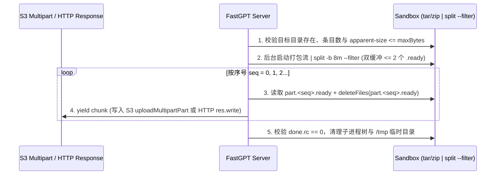
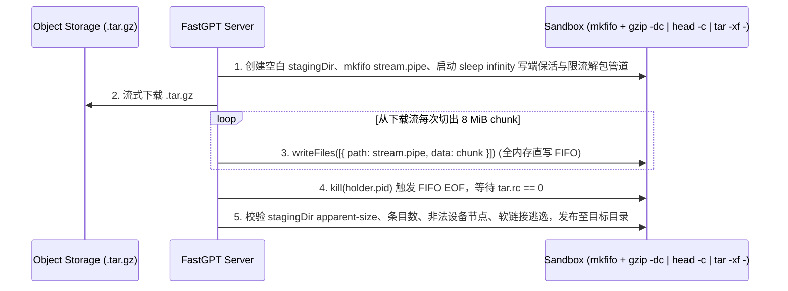

# Agent Sandbox 与 Skill 全链路流式归档、发布、部署与下载设计

状态：设计定稿，待实施

最后核对：2026-10-14

## 1. 背景与全链路痛点盘点

### 1.1 现状全链路问题（6 个场景）

当前 Sandbox 与 Skill 涉及打包、归档、发布、部署和下载的 6 条链路均存在「沙盒内落盘完整 `.zip`」或「服务端整包 `Buffer` / `JSZip` 内存驻留」的瓶颈：

| 链路 | 涉及代码 | 当前实现做法 | 核心瓶颈 |
| --- | --- | --- | --- |
| **① Sandbox 冷归档与恢复** | `sandbox/application/archive.ts`<br>`common/s3/sources/sandbox/index.ts` | 在 `/workspace` 落盘 `.fastgpt-sandbox-archive.zip` / `.fastgpt-sandbox-restore.zip`；服务端整包 `Buffer` 读写 S3 `package.zip` | 同一卷需同时容纳「Workspace + ZIP」，导致 `getAgentSandboxDiskBytes()` 被迫 `/ 2` 折半；服务端并发归档/恢复易 OOM |
| **② Skill 编辑工作区「保存并发布」** | `sandbox/application/skillEdit/deploy.ts`<br>`sandbox/application/skillEdit/runtime.ts`<br>`common/s3/sources/skill/index.ts` | `packageSkillInSandbox` 在沙盒 `$HOME/.fastgpt/tmp/*.zip` 落盘完整 `.zip`，`readFiles` 读入服务端整包 `Buffer`，再用 `JSZip.loadAsync(zipBuffer)` 全量进内存校验与提取 `SKILL.md`，最后上传 S3 `.zip` | 沙盒落盘完整包；服务端将数百 MB 乃至数 GB 的包读入 `Buffer` 并经 `JSZip` 解包驻留内存；S3 存为 `.zip` 导致下游沙盒部署无法流式解压 |
| **③ Skill 版本包「部署注入到沙盒」**<br>（App 会话注入 & Skill Edit 初始化/切版本） | `sandbox/application/runtime/skill/core.ts`<br>`sandbox/application/runtime/skill/prepare.ts` | 从 S3 下载 `packageStream`，调用 `sandbox.writeFiles` 在沙盒 `/workspace` 落盘完整 `package.zip`，再跑 `unzip -o -q package.zip` 解压后删除 | 完整 `package.zip` 落盘 `/workspace`；且当包 `> 32 MiB` 时，`execd` 先在 `/tmp/multipart-*` 落盘一份，再写 `/workspace`，再解压，**瞬时占用 3 倍磁盘空间** |
| **④ Skill 编辑工作区「导出下载」** | `pages/api/core/ai/skill/export.ts`<br>`sandbox/application/skillEdit/runtime.ts` | 复用 `packageSkillInSandbox` 在沙盒落盘 `.zip`、读入服务端整包 `Buffer`（硬编码 `responseLimit: '200mb'`），再 `res.end(zipBuffer)` | 沙盒落盘完整包 + 服务端整包 `Buffer` 内存峰值 + 响应体积受限 |
| **⑤ Sandbox 文件树「目录/工作区下载」** | `pages/api/core/ai/sandbox/download.ts`<br>`sandbox/application/file.ts` | `addDirectoryToArchive` 在服务端递归调用 `listDirectory`，对**每个文件单独发一次 `readFileStream` HTTP 请求**，在服务端用 `archiver('zip')` 压缩 | 目录含上千个小文件时会串行发起上千次 HTTP 请求，极慢，且丢失可执行权限与软链接 |
| **⑥ Skill 创建 / 导入 / 复制** | `skill/manage/creation/index.ts`<br>`skill/manage/import.ts`<br>`skill/package/storage.ts` | 1. 初始空白包与用户导入包均以 `.zip` 存入 S3；<br>2. `copySkillPackage` 将整包下载到服务端 `Buffer` 再重新上传 | 1. S3 存 `.zip` 使下游沙盒部署无法走 `mkfifo + tar -xzf -`；<br>2. `copySkillPackage` 未复用对象存储原生 `copyObjectInSelfBucket` |

### 1.2 底层组件与协议约束核查

结合 `alibaba/OpenSandbox`（最新 `release-1.1.1` / `execd v1.1.0` 及 `main` 分支）、`@fastgpt-sdk/sandbox-adapter`、`@fastgpt-sdk/storage` 源码与真实容器实测，确认以下硬性边界：

1. **`execd` `/files/download` 无法直接读取 `mkfifo` 命名管道**：
   `components/execd/pkg/web/controller/filesystem_download.go` 调用 `file.Stat()` 设置 `Content-Length` 后，紧接着调用 Go 标准库 `http.ServeContent(...)`。`http.ServeContent` 内部执行 `file.Seek(0, io.SeekEnd)`，而命名管道不可 `seek`（`ESPIPE`），直接返回 `HTTP 500 Internal Server Error: seeker can't seek`。
2. **`execd` `/files/upload` 单次请求超过 32 MiB 会先落盘 `/tmp/multipart-*`**：
   `components/execd/pkg/web/controller/filesystem_upload.go` 在入口调用 Gin 的 `ctx.MultipartForm()`（`ParseMultipartForm(32 << 20)`）。若单次 `writeFileStream` 传输数 GiB 流，超过 32 MiB 的部分会先被完整写入容器 `/tmp/multipart-*` 临时文件，请求结束后才拷贝至目标路径；而单次上传 `< 32 MiB`（如 `8 MiB`）时，Go 全程在内存中处理，**0 字节落盘 `/tmp/multipart-*`**。
3. **`unzip` 不支持从管道流式解包，而 `zip -` 支持向管道流式打包**：
   - **解包侧（必须用 `.tar.gz`）**：ZIP 格式的权威索引（Central Directory，存储 UNIX `0755` 权限与符号链接标记 `S_IFLNK`）位于文件最末尾。`unzip` 启动时必须 `lseek` 到文件末尾，面对 `mkfifo` 直接报错 `End-of-central-directory signature not found`；若按流式读取前面的 Local File Header，则会丢失权限与符号链接属性，且 ZIP 不支持硬链接（Hardlink）。因此**所有需要解压进沙盒的 S3 持久化包（Sandbox 归档 + Skill 版本包）必须统一为 `.tar.gz`**。
   - **打包侧（面向用户下载可流式输出 `.zip`）**：Linux `zip -r -y -q - .` 在打包写出时通过 Data Descriptor（Bit 3）顺序写入数据并在流末尾追加 Central Directory，支持直接通过 stdout 管道传给 `split -b 8m --filter`，无需在沙盒落盘完整 `.zip`。
4. **沙盒私网隔离与多云存储约束**：
   沙盒默认阻断私网出口（`10.0.0.0/8`、`172.16.0.0/12`、`192.168.0.0/16`、`localhost`），沙盒直连 S3 预签名 URL 的方案在内网 MinIO 部署下不可达；同时 `SealosDevboxAdapter` 不支持 `executeBackground`（`capabilities.command.background = false`），且沙盒镜像默认未预装 `zstd`。

---

## 2. 目标与核心不变量

1. **S3 持久化包 100% 统一为 `.tar.gz`，对外用户交互保持 `.zip`**：
   - **S3 内部持久化**：
     - Sandbox 冷归档：`sandbox/archive/<sandboxId>/package.tar.gz`
     - Skill 版本包：`agent-skills/<teamId>/<skillId>/<versionId>.tar.gz`
   - **面向用户浏览器的交互**：
     - 用户导入 Skill（`/api/core/ai/skill/import`）：保持上传 `.zip`，服务端流式转换为 `.tar.gz` 后存入 S3，**保证落入 S3 的一定是 `.tar.gz`**。
     - 用户导出 Skill（`/api/core/ai/skill/export`）与下载沙盒目录（`/api/core/ai/sandbox/download`）：保持浏览器下载 `.zip`，底层在沙盒内通过 `zip - | split --filter` 流式分片直写 HTTP 响应。
2. **工作区零完整包落盘，沙盒磁盘容量上限翻倍**：
   归档、恢复、Skill 发布、Skill 部署、目录下载全程不在 `/workspace` 写入完整压缩包。`getAgentSandboxDiskBytes()` 移除 `/ 2` 折半限制，仅扣除 `RESERVED_DISK_MB`（`150 MiB`），10 GiB 卷可用上限由 `4.85 GiB` 提升至 `~9.85 GiB`。
3. **抽取统一的纯 Linux 原生流式原语（零 Python 依赖）**：
   - **沙盒流式打包写出原语 `streamPackFromSandbox`**：基于 `| split -b 8388608 -d -a 6 --filter=...` 在 `/tmp` 下维护最多 `2` 个 `8 MiB` `.ready` 分片（双缓冲峰值 $\le 16\text{ MiB}$），向上游暴露 `AsyncGenerator<Buffer>`，供 S3 Multipart 上传（`.tar.gz`）和 HTTP 流式响应下载（`.zip`）复用。
   - **沙盒流式解包写入原语 `streamExtractTarGzIntoSandbox`**：基于 `mkfifo` + `exec sleep infinity` 写端占位保活句柄 + 服务端 `8 MiB` 分片直写 FIFO 管道喂给 `gzip -dc | head -c ... | tar -xf -` + 沙盒内后置安全校验，供 Sandbox 冷归档恢复与 Skill 版本部署（App 运行态注入 + Skill Edit 初始化）共同复用。
4. **存量 `.zip` 自动迁移 + 按需转换兜底，沙盒内彻底移除 `unzip`**：
   沙盒容器内的恢复与 Skill 部署流程 **100% 只处理 `.tar.gz` 流式解包**。存量 S3 中的 Sandbox 归档 `.zip` 与 Skill 版本 `.zip` 通过「4.17.3 后台系统迁移任务批量转 + 恢复/部署入口按需实时转兜底」统一收敛为 `.tar.gz`。

---

## 3. 行业安全与工程最佳实践加固（Security & Best-Practice Hardening）

结合容器/沙盒归档安全实践（参考 GNU `tar` `CVE-2025-45582`、`node-tar` `CVE-2026-23745`、`docker cp` `CVE-2026-17106`、GitHub Actions `actions/cache` 与 Kubernetes `kubectl cp` 防护规范），在全链路强制落地以下 6 项加固：

1. **独立空白 Staging 目录解包 + GNU `tar` 最小权限参数（阻断 `CVE-2025-45582` 多步软链接覆盖）**：
   - **绝不在非空目录上直接叠加运行 `tar -xf`**：每次解包必须先创建全新的空目录 `$STAGING_DIR`（`rm -rf "$STAGING_DIR" && mkdir -p "$STAGING_DIR"`），避免利用已有软链接实现跨目录写入。
   - **显式安全解包参数**：统一使用 `--no-same-owner --no-same-permissions --no-overwrite-dir --keep-directory-symlink` 配合 `umask 0022`（保留常规可执行位 `0755`，但自动剥离 `setuid`/`setgid`/`sticky` 特权位与 group/other 写权限），并在解包后执行 `chmod -R a-s "$STAGING_DIR"`。
2. **解压炸弹（Decompression Bomb）与 Inode 耗尽的流中实时阻断**：
   - 不能等 `tar` 解压落地完再跑 `du -sb`（否则高压缩比全零炸弹在 `tar` 退出前就已撑爆沙盒磁盘）。
   - 解包管道改为：`gzip -dc < "$PIPE_DIR/stream.pipe" | head -c $((MAX_BYTES + 16777216)) | tar -xf - -C "$STAGING_DIR" ...`，一旦解压后的 TAR 字节流超过上限，在写入磁盘途中立即截断并令 `tar` 非零退出；同时在后置校验中检查总文件/目录条目数（`MAX_ARCHIVE_ENTRIES = 100000`）与 `du -sb --apparent-size "$STAGING_DIR"`（防止通过 `truncate` 制造逻辑大小几十 GiB 的稀疏文件绕过块统计）。
3. **软链接、硬链接与特殊设备文件三重后置校验**：
   - 禁止块设备、字符设备、FIFO、Socket（`find "$STAGING_DIR" \( -type b -o -type c -o -type p -o -type s \)` 必须为空）；
   - 遍历所有软链接（`find "$STAGING_DIR" -type l`），校验 `realpath -m` 解析后的目标路径必须位于 `$STAGING_DIR` 内部；
   - 打包侧固定携带 `--one-file-system`，防止跨越挂载点打包容器虚拟文件系统。
4. **服务端 `.zip -> .tar.gz` 转换使用 `yauzl` 懒加载流式转换（彻底淘汰 `JSZip.loadAsync` 全内存模型）**：
   - `JSZip.loadAsync(buffer)` 会将完整压缩包和所有条目对象在 V8 堆内存中一次性展开，面对大包极易 OOM。
   - 复用 `@fastgpt/service` 已安装的 `yauzl`（`{ lazyEntries: true, decodeStrings: true, validateEntrySizes: true, strictFileNames: true }`）：将待转换的 `.zip` 流（用户导入或历史 S3 归档）带 `maxBytes` 限流暂存至服务端 OS 临时文件（`os.tmpdir()`），通过 `yauzl.open` 逐条读取文件流，实时校验**真实解压字节数累加**（不盲信 ZIP Header 声明的 `uncompressedSize`）、条目数上限与路径安全，流式打入 `tar` + `zlib.createGzip({ level: 1 })` 上传 S3，并在 `finally` 中 `unlink` 临时文件。
5. **`zip -` 流式导出与导入的闭环兼容保障**：
   - 面向浏览器下载的 `zip -r -y -q - .` 使用流式 Data Descriptor，其权威大小与 UNIX 权限均写入末尾 Central Directory；而服务端导入使用的 `yauzl` 恰从末尾 Central Directory 解析条目属性。单测中必须包含「`export` 流式导出的 `.zip` 直接传给 `import` 转换为 `.tar.gz`」的端到端兼容测试。
6. **沙盒后台管道的进程树完整清理（防孤儿进程残留）**：
   - `nohup bash -c 'tar ... | split ...' &` 启动后，`$!` 仅为外层 shell 的 PID。异常中断或 `finally` 清理时，必须执行 `pkill -KILL -P "$PID" 2>/dev/null || true; kill -KILL "$PID" 2>/dev/null || true` 同时终止 `tar`、`gzip`、`split`、`sleep` 子进程，再删除 `/tmp/.fastgpt-*` 临时目录。

---

## 4. 详细技术方案

### 4.1 容量与常量配置

1. **`packages/service/core/ai/sandbox/config.ts`**：
   ```ts
   export const getAgentSandboxDiskBytes = () => {
     const storageMB = serviceEnv.AGENT_SANDBOX_STORAGE_SIZE_GI * 1024;
     const diskMB = Math.round(storageMB - RESERVED_DISK_MB);
     if (diskMB <= 0) {
       throw new Error(
         `AGENT_SANDBOX_STORAGE_SIZE_GI must be greater than ${RESERVED_DISK_MB}MiB`
       );
     }
     return diskMB * MB_BYTES;
   };
   ```
2. **`packages/service/core/ai/sandbox/constants.ts`**：
   - `SANDBOX_ARCHIVE_STREAM_CHUNK_BYTES = 8 * 1024 * 1024`（`8 MiB`：同时满足 S3 Multipart $\ge 5\text{ MiB}$ 下限与 `execd` Gin `ParseMultipartForm < 32\text{ MiB}$ 纯内存上限）；
   - `SANDBOX_ARCHIVE_STREAM_MAX_READY_PARTS = 2`（双缓冲槽位，沙盒 `/tmp` 峰值缓冲 $\le 16\text{ MiB}$）；
   - `SANDBOX_ARCHIVE_MAX_ENTRIES = 100_000`（单次归档/解包最大条目数上限，防 Inode 耗尽）。

---

### 4.2 通用原语一：沙盒流式打包写出（`streamPackFromSandbox`）

服务于：**① Sandbox 冷归档（`.tar.gz`）**、**② Skill 保存发布（`.tar.gz`）**、**④ Skill 导出下载（`.zip`）**、**⑤ Sandbox 目录下载（`.zip`）**。



1. **沙盒内生产命令模板**：
   - 创建独立临时目录 `TEMP_DIR="/tmp/.fastgpt-pack-<id>"`；
   - **输出 `.tar.gz` 时（用于写入 S3）**：
     - 全目录归档：`tar -I "gzip -1" --one-file-system --warning=no-file-changed -cf - -C "$TARGET_DIR" .`
     - 带 `.gitignore` 过滤（Skill 保存发布）：复用 `parseGitignoreRules` 生成的 `pruneClause`，通过 `cd "$TARGET_DIR" && find . \( $PRUNE_CLAUSE \) -prune -o -print0 | tar --null --no-recursion -I "gzip -1" --one-file-system --warning=no-file-changed -cf - -T -` 精确打包未忽略的目录、文件与软链接。
   - **输出 `.zip` 时（用于浏览器直接下载）**：
     - `cd "$TARGET_DIR" && zip -r -y -q - . $EXCLUDE_ARGS`（直接向 stdout 流式输出 `.zip`）。
   - **下游 `split --filter` 双缓冲管道**：
     ```sh
     | split -b 8388608 -d -a 6 --filter="
         while [ \$(ls \"$TEMP_DIR\"/*.ready 2>/dev/null | wc -l) -ge 2 ]; do sleep 0.01; done
         cat > \"$TEMP_DIR/\$FILE.tmp\" && mv \"$TEMP_DIR/\$FILE.tmp\" \"$TEMP_DIR/\$FILE.ready\"
       " - part.
     ```
2. **服务端消费与 S3 Multipart 封装（`uploadStreamPartsToS3`）**：
   - 消费 `streamPackFromSandbox` 产出的 `8 MiB` `Buffer`：
     - 若总分片数只有 1 片且 `< 5 MiB`（或空工作区），直接调用单次 `uploadObject`（规避对象存储对单分片 `< 5 MiB` 的限制，且少一次网络往返）；
     - 若有多个分片（第 1 片已满 `8 MiB` 且读到第 2 片），调用 `createMultipartUpload` 后按 `partNumber = 1, 2, ...` 调用 `uploadMultipartPart`，结束时调用 `completeMultipartUpload`；异常时在 `finally` 中调用 `abortMultipartUpload` 并执行 `pkill -KILL -P "$PID"; kill -KILL "$PID"; rm -rf "$TEMP_DIR"`。

---

### 4.3 通用原语二：沙盒流式解包写入（`streamExtractTarGzIntoSandbox`）

服务于：**① Sandbox 冷归档恢复**、**③ App 运行态注入已发布 Skill（`runtime/skill/core.ts`）**、**③ Skill Edit 初始化/切版本部署（`runtime/skill/prepare.ts`）**。



1. **沙盒内 FIFO 管道、写端保活与实时限流解包初始化**：
   ```sh
   rm -rf "$PIPE_DIR" "$STAGING_DIR" && mkdir -p "$PIPE_DIR" "$STAGING_DIR"
   mkfifo "$PIPE_DIR/stream.pipe"
   nohup sh -c 'exec sleep infinity > "$1"' _ "$PIPE_DIR/stream.pipe" >/dev/null 2>&1 </dev/null &
   echo $! > "$PIPE_DIR/holder.pid"
   nohup bash -c '
     set -o pipefail
     umask 0022
     gzip -dc < "$2" \
       | head -c "$4" \
       | tar -xf - -C "$1" --no-same-owner --no-same-permissions --no-overwrite-dir --keep-directory-symlink 2>"$3/tar.err"
     echo $? > "$3/tar.rc"
   ' _ "$STAGING_DIR" "$PIPE_DIR/stream.pipe" "$PIPE_DIR" "$MAX_TAR_STREAM_BYTES" >/dev/null 2>&1 </dev/null &
   echo $! > "$PIPE_DIR/tar.pid"
   ```
2. **服务端 `8 MiB` 切块直写与后置安全校验**：
   - 服务端从 S3 `Readable` 流按 `8 MiB` 攒块并调用 `sandbox.writeFiles([{ path: pipePath, data: chunk }])`；
   - 流结束后杀死 `holder.pid`，等待 `tar.rc == 0`；
   - 在将 `$STAGING_DIR` 移动/发布到目标目录（`workDirectory` 或 `skillsRootPath/<versionId>`）前，统一在沙盒内执行安全校验：
     1. `du -sb --apparent-size "$STAGING_DIR"` 实际逻辑字节数 `<= maxBytes`，且总条目数 `<= SANDBOX_ARCHIVE_MAX_ENTRIES`；
     2. 无块设备、字符设备、FIFO、Socket 等特殊文件（`find "$STAGING_DIR" \( -type b -o -type c -o -type p -o -type s \)` 为空）；
     3. 所有符号链接经 `realpath -m` 解析后的目标路径必须位于 `$STAGING_DIR` 内部，拒绝任何越界软链接；
     4. 执行 `chmod -R a-s "$STAGING_DIR"` 确保无残留 SUID/SGID 位。

---

### 4.4 各业务链路改造细则

#### 1. Skill 编辑工作区「保存并发布」（`saveDeploySkillFromSandbox`）
- **沙盒内前置校验与 `runtimeSkills` 提取（彻底告别服务端 `JSZip.loadAsync`）**：
  - 在沙盒内检查 `targetDir` 下文件总大小（排除 `.gitignore` 忽略项）不超过 `getAgentSandboxSkillMaxBytes()`，且不包含越界软链接；
  - 在沙盒内查找 `skills/*/SKILL.md`（兼容一级目录或根目录 `SKILL.md`），通过 `sandbox.readFiles` 仅读取这些几 KB 的 `SKILL.md` 文本，在服务端调用 `parseSkillMarkdown` 校验 frontmatter 并构建 `runtimeSkills: RuntimeSkillMetadataType[]`；若不存在任何有效 `SKILL.md`，直接报错拒绝发布，无需打包上传。
- **流式打包直传 S3 `.tar.gz`**：
  - 调用 `streamPackFromSandbox`（格式 `tar.gz`，应用 `.gitignore` 过滤）+ Multipart 上传至 `agent-skills/<teamId>/<skillId>/<versionId>.tar.gz`（写入临时 S3 TTL，在 Mongo 事务绑定 `versionId` 成功后移除 TTL）。

#### 2. Skill 导入、新建与复制（保证 S3 一律为 `.tar.gz`）
- **导入（`/api/core/ai/skill/import` -> `importSkill`）**：
  - 前端与 API 入参保持接收 `.zip` 文件流；
  - 服务端在 `importSkill` 中通过基于 `yauzl` 的流式转换器将上传的 `.zip` 校验（路径安全、条目数上限、真实解压流字节数 $\le \text{maxBytes}$）并流式转换为 `.tar.gz`，上传至 `agent-skills/<teamId>/<skillId>/<versionId>.tar.gz`。
- **新建空白工作区（`completePendingSkillCreation`）**：
  - `createBlankSkillWorkspacePackage()` 直接生成包含 `.gitignore` 与 `skills/` 空目录的 `.tar.gz` Buffer 并上传至 `agent-skills/<teamId>/<skillId>/<versionId>.tar.gz`。
- **复制（`copySkillPackage`）**：
  - 若源 `sourceStorageKey` 已是 `.tar.gz`，直接调用 `getS3SkillSource().copy({ from: sourceStorageKey, to: targetKey, options: { temporary: true } })` 走对象存储服务端拷贝，**0 字节经过 FastGPT Server 内存**；
  - 若源 `sourceStorageKey` 是尚未迁移的旧 `.zip`，先调用 `ensureTarGzSkillPackage` 转为 `.tar.gz` 再拷贝。

#### 3. Skill 导出（`/api/core/ai/skill/export`）与 Sandbox 目录下载（`/api/core/ai/sandbox/download`）
- 两者面向浏览器均保持响应 `Content-Type: application/zip` 与 `.zip` 文件名；
- 移除 `export.ts` 的整包 `Buffer` 缓冲，移除 `sandbox/download.ts` 的逐文件 `listDirectory + readFileStream + archiver` 慢路径；
- 统一调用 `streamPackFromSandbox({ format: 'zip', ... })`，服务端每拉取一个 `8 MiB` 分片即写入 `res` 流。

---

### 4.5 存量 `.zip` 转换方案（自动迁移任务 + 恢复/部署前按需转换兜底）

为了保证 S3 全面收敛为 `.tar.gz`，且沙盒内不保留任何 `.zip` / `unzip` 兼容代码，采用**共用服务端 `yauzl` `zip -> tar.gz` 流式转换核心 + 双通道（按需兜底 + 后台自动迁移）**设计：

#### 1. 通用转换核心 `convertZipToTarGz`（基于 `yauzl` 懒加载流）
- 将输入 `.zip` 流带 `maxBytes` 限流暂存至服务端 OS 临时文件（`os.tmpdir()`），使用 `yauzl.open(tempZipPath, { lazyEntries: true, decodeStrings: true, validateEntrySizes: true, strictFileNames: true })` 逐条读取；
- 提取路径、目录标记、UNIX 权限 mode（剥离 SUID/SGID 位）、符号链接 `S_IFLNK` 目标路径；
- 校验路径无 `..` 或绝对路径、软链接不逃逸根目录、总条目数 `<= SANDBOX_ARCHIVE_MAX_ENTRIES`、流中真实解压字节数累加 `<= maxBytes`；
- 按原始权限、软链接与目录结构流式写入 `tar` 并经 `zlib.createGzip({ level: 1 })` 压缩输出至 S3（并在 `finally` 中清理 OS 临时文件）。

#### 2. Sandbox 归档存量转换（`S3SandboxSource.ensureTarGzWorkspaceArchive`）
- **路径规则**：`agent_sandbox_instances_v2` 不在 Mongo 存储 key，由 `sandboxId` 确定性映射为 `sandbox/archive/<sandboxId>/package.tar.gz`（旧为 `package.zip`）。
- **转换与清理**：
  1. 若 `package.tar.gz` 已存在：清理可能残留的 `package.zip`，直接返回；
  2. 若仅 `package.zip` 存在：流式转换为 `package.tar.gz` 上传 S3（上传完成前对读取方不可见，天然原子），上传成功后删除 `package.zip`。
  3. `deleteWorkspaceArchiveNow` 同时删除 `package.tar.gz` 与 `package.zip`。
- **通道一（恢复前兜底）**：`restoreArchivedSandboxWithinLease` 在 Lifecycle Lease 内先调用 `ensureTarGzWorkspaceArchive`，再走 `.tar.gz` FIFO 恢复流。

#### 3. Skill 版本包存量转换（`ensureTarGzSkillPackage`）
- **路径规则**：`MongoAgentSkillsVersion` 的 `storageKey` 记录了具体对象路径（旧为 `agent-skills/<teamId>/<skillId>/<versionId>.zip`，新为 `.../<versionId>.tar.gz`）。
- **转换与 CAS 更新**：
  1. 若 `version.storageKey` 已以 `.tar.gz` 结尾，直接返回该 `storageKey`；
  2. 若 `version.storageKey` 以 `.zip` 结尾：
     - 目标 key 设为将末尾 `.zip` 替换为 `.tar.gz`；
     - 若目标 `.tar.gz` 在 S3 中尚不存在，下载原 `.zip` 流式转换为目标 `.tar.gz` 并上传（不挂临时 TTL，因为已是正式版本）；
     - 执行 Mongo CAS 更新：`MongoAgentSkillsVersion.updateOne({ _id: versionId, storageKey: oldZipKey }, { $set: { storageKey: newTarGzKey } })`；
     - 确认 Mongo 已指向 `newTarGzKey` 后，删除 S3 上的旧 `oldZipKey`，返回 `newTarGzKey`。
- **通道一（部署前兜底）**：在 `runtime/skill/core.ts`（App 注入 Skill）与 `runtime/skill/prepare.ts`（Skill Edit 初始化）部署前，若 `storageKey.endsWith('.zip')`，先调用 `ensureTarGzSkillPackage` 原地完成转换与 `storageKey` 更新，再走 `.tar.gz` FIFO 解包流。

#### 4. 通道二：系统自动迁移任务（`projects/app/src/migration/tasks/4173/20261014_migrate_sandbox_archive_tar_gz`）
- **注册配置**：
  - `id`: `'20261014_migrate_sandbox_archive_tar_gz'`
  - `version`: `'4.17.3'`
  - `blockStartup`: `false`
  - `onFailure`: `SystemMigrationFailurePolicyEnum.continue`
  - `progressSteps`:
    1. `sandboxArchives`（转换存量 Sandbox 归档 `package.zip -> package.tar.gz`）
    2. `skillPackages`（转换存量 Skill 版本包 `<versionId>.zip -> <versionId>.tar.gz`）
    3. `validation`（最终只读校验两类资源是否均已无残留 `.zip`）
- **分批断点续跑策略**：
  - 遵循 `tasks/README.md` 规范，使用 `systemMigrationBatchSize` 分批扫描、保存游标 checkpoint、维护 `failedRecords` 快照、执行一轮补扫（reconcile）及最终只读 `validation`。

---

## 5. 实测验证记录

基于本地真实容器（`ghcr.io/labring/fastgpt-agent-sandbox:v0.3.0-beta4` + 本地已缓存的 `opensandbox/execd` 二进制；注：上游最新 `release-1.1.1` / `execd v1.1.0` 的文件传输源码完全一致）完成两轮压测，测试容器与临时文件均已清理：

1. **20 MiB / 32 MiB 功能与安全边界测试**：
   - 验证了裸 FIFO 直接调用 `/files/download` 必现 `HTTP 500: seeker can't seek`；
   - 验证了 `tar | split --filter` 归档与 `mkfifo` + `sleep infinity` 恢复往返耗时 `1.22s`，SHA-256、`0755` 可执行权限、相对软链接、硬链接 inode 100% 一致；
   - 验证了恶意逃逸软链接（`../../etc/passwd`）拦截。
2. **5.00 GiB（5,120 MiB）混合数据全链路压测**：
   - 数据集：`2.5 GiB` 不可压缩随机二进制块 + `2.5 GiB` 可压缩文本日志 + 脚本/软硬链接，压缩后 `.tar.gz` 为 `2,575.35 MiB`。
   - **归档耗时**：`53.07s`（Workspace 读取吞吐 `96.5 MiB/s`，网络传输吞吐 `48.5 MiB/s`，`/workspace` 额外落盘 `0 B`）。
   - **恢复耗时**：`23.12s`（Workspace 写入吞吐 `221.4 MiB/s`，`/tmp` 与 `/workspace` 分片文件落盘 `0 B`）。
   - **服务端内存增量峰值**：Node.js RSS Delta Peak `133.7 MiB`（远低于旧方案 `> 2.5 GiB` 整包 Buffer）。

---

## 6. TODO

- [ ] **容量与常量**：
  - 调整 `packages/service/core/ai/sandbox/config.ts` 中 `getAgentSandboxDiskBytes()`，移除 `/ 2` 折半限制；
  - 在 `packages/service/core/ai/sandbox/constants.ts` 中新增流式分片大小（`8 MiB`）、双缓冲槽位数（`2`）与最大条目数上限常量。
- [ ] **通用流式打包/解包与转换原语**：
  - 实现沙盒流式打包原语 `streamPackFromSandbox`（支持 `tar.gz` 与 `zip` 两种管道流 + `split --filter` 双缓冲分片读取 + 进程树清理）；
  - 实现沙盒流式解包原语 `streamExtractTarGzIntoSandbox`（`mkfifo` + `sleep infinity` + `gzip -dc | head -c | tar -xf -` 实时限流解包 + 大小/条目数/特殊文件/软链接安全校验）；
  - 实现服务端基于 `yauzl` 懒加载的 `zip -> tar.gz` 流式转换工具（解析 ZIP Central Directory 保留权限与软链接，真实解压字节限流并输出 `.tar.gz` 流）。
- [ ] **Sandbox 冷归档与恢复（链路 ①）**：
  - 扩展 `packages/service/common/s3/sources/sandbox/index.ts`（默认 `package.tar.gz`、Multipart 上传、流式下载、双格式删除、`ensureTarGzWorkspaceArchive`）；
  - 重构 `packages/service/core/ai/sandbox/application/archive.ts` 接入 `streamPackFromSandbox` 与 `streamExtractTarGzIntoSandbox`，移除沙盒内 `zip`/`unzip` 逻辑。
- [ ] **Skill 发布、导入、新建、复制与沙盒部署（链路 ②、③、⑥）**：
  - 扩展 `packages/service/common/s3/sources/skill/index.ts` 与 `packages/service/core/ai/skill/package/storage.ts`：S3 key 统一为 `<versionId>.tar.gz`，支持 Multipart 流式上传、`copyObjectInSelfBucket` 原生拷贝及 `ensureTarGzSkillPackage` 转换；
  - 重构 `saveDeploySkillFromSandbox` / `packageSkillInSandbox`：沙盒内前置校验并读取 `SKILL.md` 提取 `runtimeSkills`，通过 `streamPackFromSandbox` 流式上传 `.tar.gz` 到 S3；
  - 调整 `importSkill`（接收用户上传的 `.zip` 通过 `yauzl` 流式转换为 `.tar.gz` 存 S3）与 `createBlankSkillWorkspacePackage`（生成空白 `.tar.gz`）；
  - 重构 `packages/service/core/ai/sandbox/application/runtime/skill/core.ts` 与 `prepare.ts`：部署前通过 `ensureTarGzSkillPackage` 兜底转换旧 `.zip`，统一使用 `streamExtractTarGzIntoSandbox` 流式解包注入沙盒。
- [ ] **Skill 导出与沙盒目录下载（链路 ④、⑤）**：
  - 重构 `/api/core/ai/skill/export` 与 `/api/core/ai/sandbox/download`：保持对外输出 `.zip`，底层通过 `streamPackFromSandbox({ format: 'zip' })` 流式分片直写 HTTP `res`。
- [ ] **系统自动迁移任务**：
  - 新增 `projects/app/src/migration/tasks/4173/20261014_migrate_sandbox_archive_tar_gz`，分阶段完成 Sandbox 归档与 Skill 版本包的存量 `.zip -> .tar.gz` 迁移与最终校验。
- [ ] **单元测试**：
  - 补充并运行 Sandbox 归档/恢复、Skill 打包/导入/导出/部署（含 `export -> import` 闭环兼容）、沙盒目录下载及 4.17.3 迁移任务的局部单元测试。
